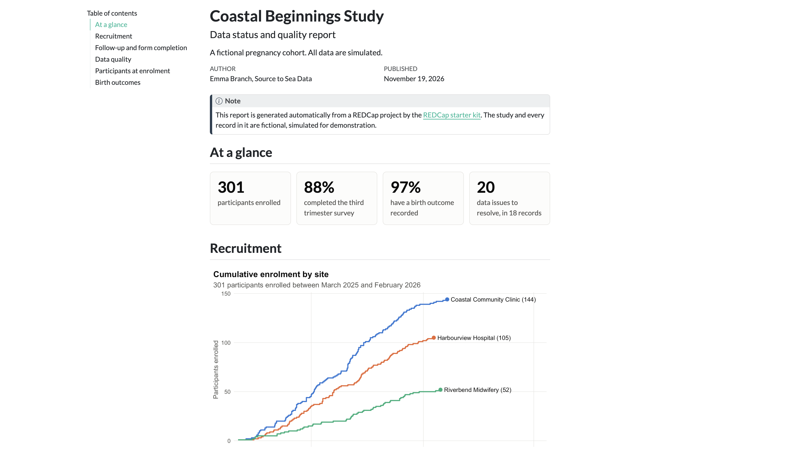

# REDCap starter kit

A small, reusable pipeline for REDCap projects: pull the data, clean it using the project's own data dictionary, run quality checks, and produce a polished status report automatically.

It is demonstrated on the **Coastal Beginnings Study**, a fictional pregnancy cohort. **All data are simulated. No real people are represented.**

**[View the live report](https://emmabranch.github.io/redcap-starter-kit/)**



## What it does

1. **Defines a realistic REDCap project.** A longitudinal data dictionary with three events, required fields, range validation, branching logic, calculated fields (BMI, gestational age, a preterm flag), cross-event references, and identifier flags on dates.
2. **Pulls the data** live from the REDCap API with [REDCapR](https://ouhscbbmc.github.io/REDCapR/), or from a local REDCap-format export when no credentials are set.
3. **Cleans it using the data dictionary.** Field types and labels come from the dictionary, not hard-coded rules, so the same code adapts to other projects.
4. **Runs six quality checks** and writes a list of issues a study coordinator can work through.
5. **Renders a Quarto report** with recruitment, follow-up, data quality, baseline characteristics, and outcome graphics.

## The quality checks

| Check | What it finds | Driven by |
|---|---|---|
| Out of range | Values outside the allowed minimum and maximum | Data dictionary |
| Missing required field | Required questions left blank, only where they should have been shown | Data dictionary and branching logic |
| Branching logic violation | Values in questions that should be hidden | Data dictionary |
| Date order | Dates across events in an impossible order | Study rules |
| Implausible gestational age | Gestational age at birth outside 22 to 44 weeks | Study rules |
| Possible duplicate | The same person enrolled under two record IDs | Study rules |

REDCap's range checks and required fields only warn at data entry, and values stay behind when branching logic changes, so these problems are common in real projects. The simulated data has 18 problems planted on purpose, and the checks catch all 18.

## Project structure

```
redcap-starter-kit/
├── data-dictionary/        REDCap data dictionary, events, and instrument mapping
├── data/
│   ├── raw/                Synthetic REDCap export and the list of planted issues
│   └── processed/          Cleaned, typed, and labelled data
├── R/
│   ├── 00_functions.R      Shared helpers (dictionary parsing, branching logic, data access)
│   ├── 01_simulate_data.R  Simulates the fictional cohort
│   ├── 02_pull_and_clean.R Pulls and cleans the data
│   └── 03_quality_checks.R Runs the quality checks
├── report/                 Quarto report
├── outputs/                Issue list and summaries (CSV)
├── docs/                   Published report for GitHub Pages
└── run_all.R               Runs everything in order
```

## How to run it

You need R (4.3 or later), [Quarto](https://quarto.org/), and these packages:

```r
install.packages(c("tidyverse", "REDCapR", "here", "gt", "glue", "scales",
                   "quarto", "reactable"))
```

Then open `redcap-starter-kit.Rproj` in RStudio and run:

```r
source("run_all.R")
```

The report is saved to `docs/index.html`.

## Using it with a real REDCap project

1. Ask your REDCap administrator for API access to the project, and generate a token.
2. Create a file called `.Renviron` in the project folder (it is already excluded from Git) containing:

   ```
   REDCAP_URI=https://your-institution.ca/redcap/api/
   REDCAP_TOKEN=your-token-here
   ```

3. Restart R and run `source("run_all.R")`. The simulation step is skipped and the data are pulled live.

The cleaning and the first three quality checks work on any project. The date rules, gestational age check, duplicate check, and report sections are specific to this study and are the parts to adapt.

**Never commit an API token, and never publish a report built from real participant data.**

## About

Built by Emma Branch at **Source to Sea Data**: research data, start to finish, from database design to the final map.
