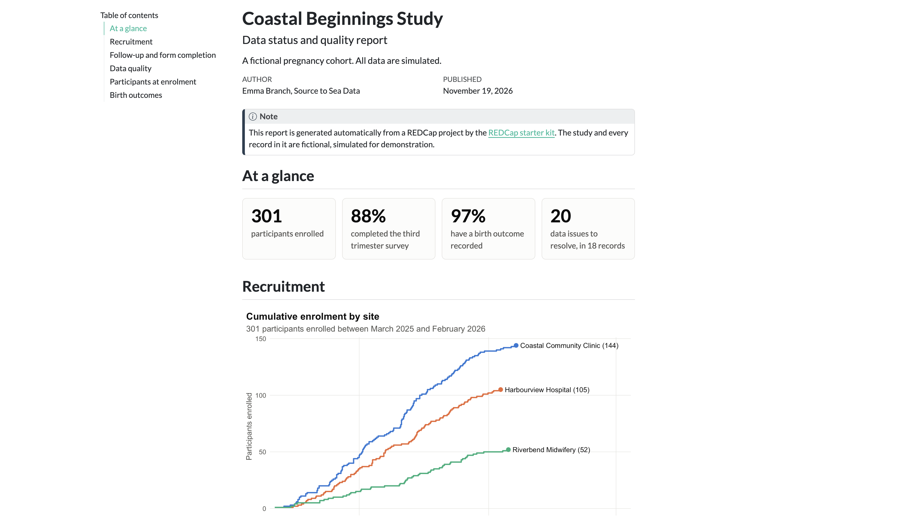

```{r}
#| label: setup
library(dplyr)
library(here)

participants <- readRDS(here("data", "processed", "participants.rds"))
scorecard    <- readRDS(here("data", "processed", "qc_scorecard.rds"))

n_enrolled <- nrow(participants)
n_sites    <- n_distinct(participants$site, na.rm = TRUE)
n_caught   <- sum(scorecard$caught)
n_planted  <- nrow(scorecard)
```

```{r}
#| label: hero-stripes
#| include: false
# Hero background: one stripe per week of enrolment, brighter in busier weeks
enrol_weeks <- as.Date(cut(participants$enrol_date[!is.na(participants$enrol_date)], "week"))
all_weeks   <- seq(min(enrol_weeks), max(enrol_weeks), by = "week")
week_n      <- as.integer(table(factor(as.character(enrol_weeks), levels = as.character(all_weeks))))
stripe_col  <- scales::col_numeric(c("#2a1f3d", "#6b4c9a", "#c9b2ea"), domain = c(0, max(week_n)))(week_n)
w <- 1000 / length(week_n)
rects <- sprintf('<rect x="%.2f" y="0" width="%.2f" height="26" fill="%s"></rect>',
                 (seq_along(week_n) - 1) * w, w + 0.6, stripe_col)
stripes_html <- paste0('<div class="hero-bg" aria-hidden="true"><svg viewBox="0 0 1000 26" preserveAspectRatio="none">',
                       paste(rects, collapse = ""), '</svg></div>')
```

::::: {.hero-full .column-screen}

```{r}
#| label: hero-bg
#| output: asis
cat(stripes_html)
```

```{=html}

```

:::: {.hero-inner}

[Portfolio project · R · REDCap · Quarto]{.eyebrow}

# REDCap starter kit. [From REDCap project to quality-checked report.]{.accent}

This kit pulls records from REDCap with REDCapR, uses the project's own data dictionary to drive cleaning and labelling, runs six data quality checks, and renders a status report. It is demonstrated on a fictional pregnancy cohort with synthetic data.

[Read the sample report](report/index.html){.btn .btn-accent} [How it works](how-it-works.qmd){.btn .btn-ghost} [Code on GitHub](https://github.com/emmabranch/redcap-starter-kit){.btn .btn-ghost}

[Background: one stripe per week of enrolment in the sample study, brighter in busier weeks.]{.hero-note}

::::

:::::

```{r}
#| label: stats
#| output: asis
cat(sprintf('<div class="stat-row lift">
<div class="stat-box"><span class="num">%s</span><span class="lab">participants in the sample study, all simulated</span></div>
<div class="stat-box"><span class="num">%s</span><span class="lab">study sites</span></div>
<div class="stat-box"><span class="num">6</span><span class="lab">quality checks, most driven by the data dictionary</span></div>
<div class="stat-box"><span class="num">%s of %s</span><span class="lab">problems planted on purpose, caught by the checks</span></div>
</div>', n_enrolled, n_sites, n_caught, n_planted))
```

::: {.project-note}
It is demonstrated on the **Coastal Beginnings Study**, a fictional pregnancy cohort. **All data are simulated. No real people are represented.**
:::

## What it does

1. **Defines a realistic REDCap project.** A longitudinal data dictionary with three events, required fields, range validation, branching logic, calculated fields (BMI, gestational age, a preterm flag), cross-event references, and identifier flags on dates.
2. **Pulls the data** live from the REDCap API with [REDCapR](https://ouhscbbmc.github.io/REDCapR/), or from a local REDCap-format export when no credentials are set.
3. **Cleans it using the data dictionary.** Field types and labels come from the dictionary, not hard-coded rules, so the same code adapts to other projects.
4. **Runs six quality checks** and writes a list of issues a study coordinator can work through.
5. **Renders a Quarto report** with recruitment, follow-up, data quality, baseline characteristics, and outcome graphics.

## The sample report

::: {.report-card}
{fig-alt="Preview of the Coastal Beginnings report"}

::: {}
### Coastal Beginnings Study

A data status and quality report, generated automatically from the REDCap project. It is a single self-contained file, so a study coordinator can email it or open it offline.

[Read the sample report](report/index.html){.btn .btn-accent}
:::
:::

## What's here

- **[How it works](how-it-works.qmd):** the pipeline, the six quality checks, and how to use it with a real REDCap project.
- **[Sample report](report/index.html):** the report the kit produces for the fictional Coastal Beginnings Study.
- **[About the data](about.qmd):** where the data come from, the licences, and who made this.
